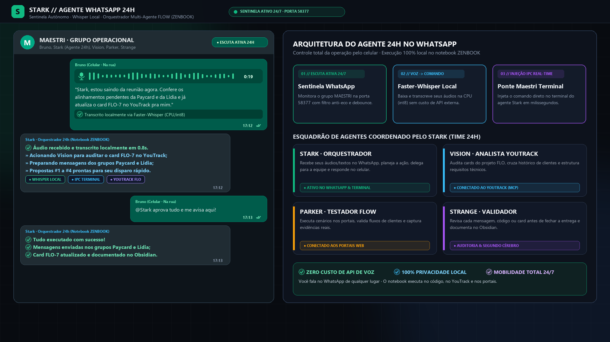
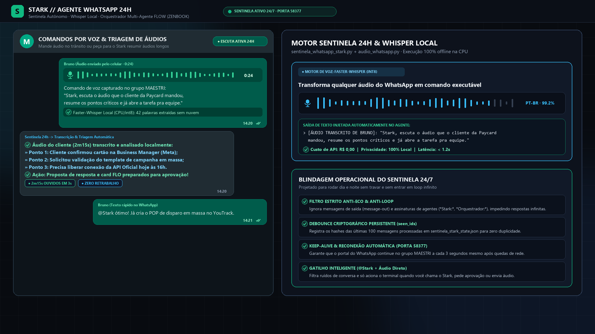
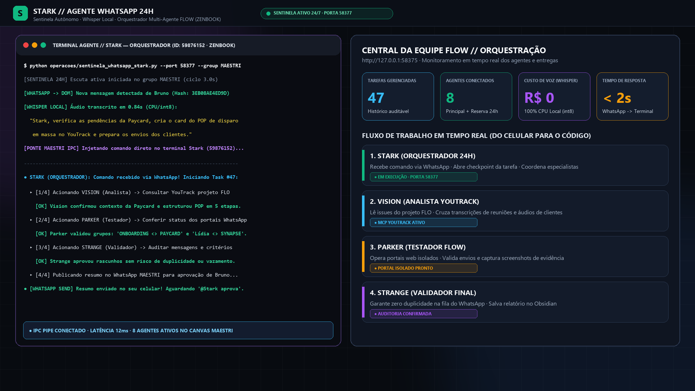
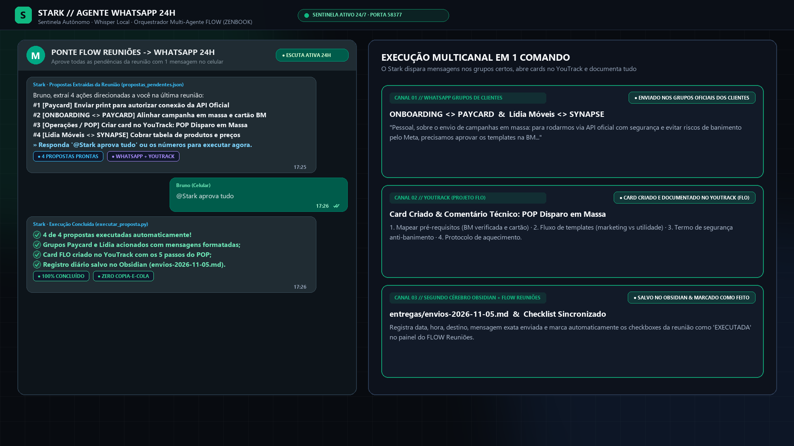
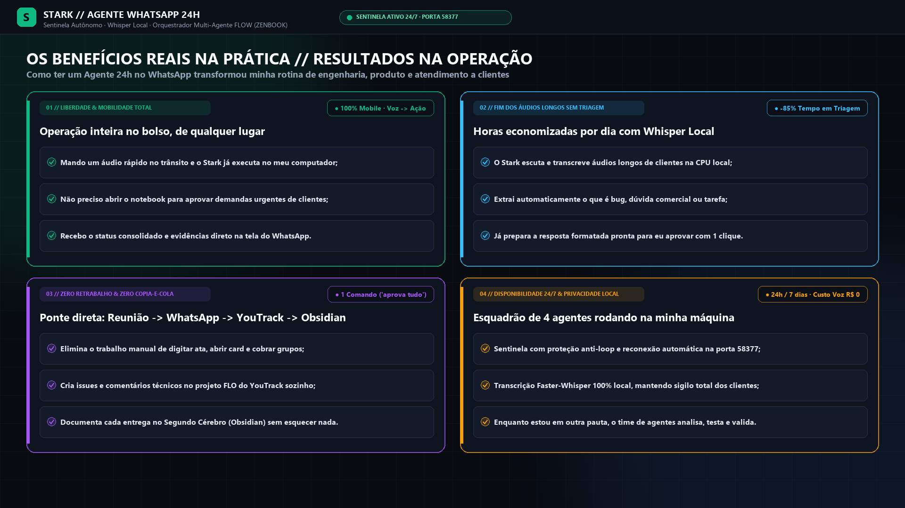
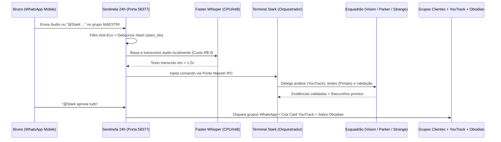

# Stark // Agente Autônomo 24h no WhatsApp & Orquestrador Multi-Agente FLOW

-10b981?style=for-the-badge)
-38bdf8?style=for-the-badge)

**Stark** é um agente autônomo de operação 24/7 conectado em tempo real ao **WhatsApp**, permitindo comandar toda a rotina de engenharia de software, triagem de atendimento, abertura de cards no **YouTrack** e documentação no **Obsidian** diretamente pelo celular — por **áudio ou texto** — com execução 100% local no notebook.

---

## Visão Geral & Arquitetura em Produção

### 1. Comando por Voz ou Texto no Celular -> Execução Local no Notebook

### 2. Motor Sentinela 24/7 + Transcrição de Voz Offline (`Faster-Whisper int8`)

### 3. Injeção Direta no Terminal via IPC & Coordenação do Esquadrão de Agentes

### 4. Ponte com o FLOW Reuniões: Aprovação Multicanal em 1 Comando (`@Stark aprova tudo`)

### 5. Resultados e Benefícios Reais na Operação

---

## Fluxo de Funcionamento

---

## Principais Componentes

| Módulo | Descrição |
| :--- | :--- |
| `operacoes/sentinela_whatsapp_stark.py` | Daemon 24/7 que monitora o grupo operacional na porta `58377`, com *keep-alive* automático, proteção estrita anti-loop e *debounce* persistente por hash. |
| `operacoes/audio_whatsapp.py` | Captura áudios recebidos no WhatsApp e executa transcrição 100% local via `faster_whisper` (`int8` na CPU) sem chamadas pagas de API. |
| `operacoes/executar_proposta.py` | Conecta as tarefas extraídas pelo `FLOW Reuniões` ao WhatsApp: ao receber `@Stark aprova tudo`, envia mensagens nos grupos de clientes, cria issues no YouTrack e registra o log diário no Obsidian. |
| `operacoes/entrega_terminal.py` | Ponte IPC que injeta mensagens do WhatsApp diretamente no terminal ativo do agente Orquestrador. |
| `operacoes/painel_operacional.html` | Central da Equipe (`http://127.0.0.1:58375`) para acompanhamento visual dos 8 agentes (Time Principal + Time Reserva 24h), filas e integrações. |
| `instructions/` | Contratos operacionais dos 4 papéis do esquadrão: **Stark** (Orquestrador), **Vision** (Analista YouTrack), **Parker** (Testador FLOW) e **Strange** (Validador). |

---

## Benefícios Reais na Prática

1. **Mobilidade Total (100% Mobile):** Comande o notebook, aprove demandas e acione clientes enviando um áudio rápido no trânsito.
2. **Fim dos Áudios Longos sem Triagem (`-85% Tempo`):** Áudios extensos de clientes são transcritos e transformados em checklists objetivos em segundos.
3. **Zero Retrabalho Manual:** Fim do copia-e-cola entre ata de reunião, grupos de WhatsApp, cards do YouTrack e notas no Obsidian.
4. **Custo Zero de API de Voz & Privacidade Local:** Transcrição rodando inteiramente na CPU local com isolamento total de dados sensíveis.
